  

    

  <a href="mailto:a.wesam2300@nu.edu.eg">Get in touch</a>
  &nbsp;·&nbsp;
  <a href="https://www.linkedin.com/in/ahmed-wesam/">LinkedIn</a>
  &nbsp;·&nbsp;
  <a href="https://github.com/AGhaith?tab=repositories">Repositories</a>

## About

I'm Ahmed, a Computer Science student at Nile University, based in Sheikh Zayed, Cairo. I build .NET APIs, React interfaces, and the self-hosted infrastructure that connects them.

I also share practical developer guides and workshop materials, and lead the **SU Technical Committee**.

## Leadership & community

- **Microsoft Learn Student Ambassador** — Technical sessions and workshops on backend development and cloud systems.
- **Google Developer Groups on Campus** — Developer tracks and hands-on learning materials for Nile University students.
- **Samsung Innovation Campus** — Embedded microcontrollers, sensor telemetry, and hardware integration.

## Guides & learning resources

| Repository | What you'll find |
| --- | --- |
| **[GitHub Guide](https://github.com/AGhaith/GitHub-Guide)** | Branching workflows, merge conflict resolution, and repository organization. |
| **[VS Code Guide](https://github.com/AGhaith/VS-Code-Guide)** | Editor configuration, keyboard shortcuts, debugging, and toolchain setup. |
| **[GDG Sessions](https://github.com/AGhaith/Google-Development-Group)** | Workshop code and exercises for campus developer sessions. |
| **[Academic Coursework](https://github.com/AGhaith/educational-projects)** | Data structures, algorithms, and coursework implementations. |

## Let's connect

Interested in backend systems, developer education, or a project we could build together? Reach me at **[a.wesam2300@nu.edu.eg](mailto:a.wesam2300@nu.edu.eg)** or connect on **[LinkedIn](https://www.linkedin.com/in/ahmed-wesam/)**.
